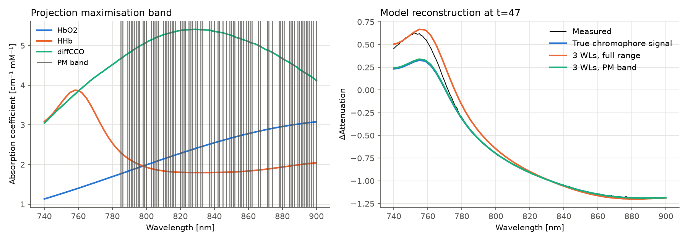

# Unified Wavelength Selection for Diffuse Spectroscopy

[](https://arxiv.org/abs/2606.23223)
[](LICENSE)


Reference implementation of

> **A unified perspective on wavelength selection for molecular composition inference from diffuse spectroscopy**<br>
> Kevin Scibilia, Marcel Rosier, Luca Giannoni, Pietro Ricci, Frédéric Lange, Francesco S. Pavone, Ilias Tachtsidis, Daniel Rueckert, Ivan Ezhov<br>
> *arXiv:2606.23223*, 2026

`wlselect` answers a practical question in broadband NIRS and hyperspectral imaging:
**which (and how few) wavelengths do I need to infer chromophore concentrations reliably?**
It brings the wavelength-selection paradigms from the literature into one framework,
adds the paper's **projection maximisation** method for band selection, and provides fast
search algorithms (brute force, SBS/SFS, differential evolution) that work with any of them.



*Synthetic example (`examples/03_projection_maximization.py`): an absorber at ~750 nm is missing
from the model. Projection maximisation discards that band (left). A 3-wavelength set chosen
inside the band reproduces the true chromophore signal, while one chosen on the full range is
biased (right). The ground-truth concentration NRMSE falls from 0.205 to 0.085.*

---

## The framework

All methods score a wavelength subset `Z` with an objective `J(Z)` built on the differential
modified Beer–Lambert law `ΔA = M Δc`, where `M` is the `n × m` absorption matrix and `ΔA`
holds the measured attenuation changes. `M_Z` and `ΔA_Z` are the rows that belong to `Z`.

| Criterion | `J(Z)` | Goal | Needs `M` | Needs data | Typical use |
|---|---|---|:-:|:-:|---|
| **Concentration Preservation** (`cp`) | `NRMSE(M⁺ΔA − M_Z⁺ΔA_Z)` | min | ✓ | ✓ | minimal set |
| **Spectral Fit Preservation** (`sfp`) | `RMSE(M(M_Z⁺ΔA_Z) − ΔA)` | min | ✓ | ✓ | minimal set |
| **Model Orthogonality** (`mo`) | `∏ σᵢ(M_Z)` | max | ✓ | ✗ | minimal set, cross-check |
| **Data Orthogonality** (`do`) | `∏ σᵢ(ΔA_Z)` | max | ✗ | ✓ | model-free filter |
| **Projection Maximization** (`pm`) | `RMSE(M_Z(M_Z⁺ΔA_Z) − ΔA_Z)` | min | ✓ | ✓ | **band selection** |

The search algorithms work with every criterion:

| Algorithm | Function | Notes |
|---|---|---|
| Brute force | `brute_force` | global optimum, vectorised, optional multiprocessing |
| Sequential Backward Selection | `sequential_backward_selection` | one run yields every cardinality, fast |
| Sequential Forward Selection | `sequential_forward_selection` | greedy from the empty set |
| Differential Evolution | `differential_evolution` | SciPy integer DE, good for small `d` |

**Recommended workflow (paper, Sec. 4):** first run projection maximisation to find the band the
model can describe, then select the minimal wavelength set *within* that band using
concentration/spectral-fit preservation, and cross-check with model orthogonality.

## Installation

```bash
git clone https://github.com/<your-org>/unified-wavelength-selection.git
cd unified-wavelength-selection
pip install -e ".[plot]"        # add ",dev" for tests and linting
```

Requires Python ≥ 3.10, NumPy and SciPy. Matplotlib is optional and is used only for plotting.

## Quick start

```python
import numpy as np
import wlselect as ws

# ΔA: (n_wavelengths, n_timepoints) per subject; M: (n_wavelengths, n_chromophores)
data = ws.make_synthetic_dataset(np.arange(780, 901, 2.0), n_subjects=4, unmodelled_band=None)
M, dA, wl = data.M, data.delta_A, data.wavelengths
# with your own data: M = ws.absorption_matrix(wl, ["HbO2", "HHb", "diffCCO"])

cp = ws.ConcentrationPreservation(M, dA, wavelengths=wl)

best = ws.brute_force(cp, d=3)                    # global optimum
path = ws.sequential_backward_selection(cp, d=3)  # SBS: all d from n-1 down to 3
de   = ws.differential_evolution(cp, d=3, seed=42)

print(best.wavelengths, best.score)   # [780. 822. 900.] 0.0665
print(path[5].wavelengths)            # SBS subset with 5 wavelengths

# Band selection, then minimal selection inside the band
pm   = ws.ProjectionMaximization(M, dA, wavelengths=wl)
band = ws.sequential_backward_selection(pm, d=len(wl) // 2).final
mini = ws.sequential_backward_selection(cp, d=3, initial=band.indices).final

# Score any subset under all five criteria
ws.evaluate_subset(best.indices, M, dA)
```

More examples are in [`examples/`](examples):

| Script | Shows |
|---|---|
| `01_quickstart.py` | all criteria on synthetic data, cross-evaluation |
| `02_search_algorithms.py` | brute force vs. SBS vs. DE error curves (cf. paper Fig. 2) |
| `03_projection_maximization.py` | PM band selection followed by minimal selection (cf. Fig. 12) |

## Command-line interface

Installing the package adds a `wlselect` command:

```bash
# synthetic demo data
wlselect make-synthetic -o demo.npz

# minimal set with brute force on a coarse grid
wlselect select --data demo.npz -c cp -a brute -d 3 4 5 \
    --wl-range 780 900 --n-wavelengths 22 --n-jobs -1 -o cp_brute.json

# band selection with projection maximisation, then SBS inside the band
wlselect select --data demo.npz -c pm -a sbs -d 80 --remove-fraction 0.02 -o pm_band.json
wlselect select --data demo.npz -c cp -a sbs -d 3 --band pm_band.json   # uses results["80"]

# evaluate a given wavelength set under all criteria
wlselect evaluate --data demo.npz -w 780 830 900
```

`--band` reads the `wavelengths` of the first result stored in the JSON file (or a plain
`{"wavelengths": [...]}` file).

### Data format

Datasets are plain `.npz` files: `wavelengths` (n,), one `delta_A_<i>` array of shape
`(n, T_i)` per subject, and optionally `M`, `chromophores` and `subjects`. If `M` is missing,
it is built from the bundled spectra for the listed chromophores (default: HbO2, HHb, diffCCO).
`ws.save_dataset` / `ws.load_dataset` read and write this format.

## Reproducing the paper

The experiments use the UCL **miniCYRIL** broadband NIRS recordings of piglets undergoing
hypoxia–ischaemia (Kaynezhad et al., *Neurophotonics* 2019). The data are **not** included in
this repository. Contact the UCL Biomedical Optics Research Laboratory for access, then place
them as described in [`src/wlselect/datasets/piglets.py`](src/wlselect/datasets/piglets.py).

```bash
# optional: convert once to .npz
wlselect prepare-piglets --root "data/miniCYRIL Piglet Data" --wl-range 730 930 -o data/piglets_730_930.npz

# run all experiments (or pick: coarse fine ortho projection range740)
python experiments/reproduce_paper.py --data data/piglets_730_930.npz -e all -o results/ --n-jobs -1
```

| Experiment | Paper | Setting |
|---|---|---|
| `coarse` | Fig. 2 | CP, 780–900 nm, 22 wavelengths, 10 timepoints/piglet, d = 3…21 |
| `fine` | Fig. 3–5, Table 2 | CP and SFP, 780–900 nm, 37 wavelengths, 40 timepoints/piglet, d = 3…10 |
| `ortho` | Table 2 | MO (37 wavelengths) and DO (100 timepoints/piglet), SBS |
| `projection` | Fig. 12 | PM with SBS to d = 153 on 740–900 nm and 730–930 nm (first 10 piglets) |
| `range740` | Fig. 10–11 | CP, MO and DO on 740–900 nm |

Each experiment writes a CSV and a JSON file (and figures where applicable) with the selected
wavelengths, criterion values and runtimes. For every subset the CSV also reports the
concentration NRMSE and spectral RMSE. Brute force for `d = 10` over 37 wavelengths evaluates
3.5·10⁸ subsets, so give the `fine` experiment many cores.

## Implementation notes

* **Multiple subjects.** Pass a list of `ΔA` arrays (one per subject). Errors are computed per
  subject and averaged. Each subject's own first timepoint is its baseline.
* **NRMSE** follows Arifler et al. (2015): per chromophore, `sqrt(Σ_t(ĉ−c)² / Σ_t c²)`,
  averaged over chromophores and subjects.
* **Orthogonality metrics.** The default is the *log* of the product of singular values. It ranks
  subsets exactly like the product but cannot overflow. `metric=` also accepts `"sv_product"`,
  `"min_sv"`, `"sv_sum"` and `"condition_number"` (minimised).
* **Speed.** All criteria evaluate batches of subsets with vectorised NumPy. CP, SFP and PM can
  switch to an exact Gram-matrix formulation whose cost does not depend on the number of
  timepoints (`strategy="auto"|"direct"|"gram"`). A full PM band selection on ~10⁴ spectra
  × 244 wavelengths takes about a minute.
* **Differential evolution** uses SciPy's integer DE (`best1bin`, population 15, 40 generations,
  seed 42 by default). Duplicate wavelengths in an individual are replaced by the nearest
  unused one.
* **Projection maximisation** is trivially zero for `d ≤ m`. Use it to pick bands (large `d`),
  not minimal sets.
* **Chromophore spectra** (`src/wlselect/resources/chromophores_nir.csv`, 650–999 nm) come from
  the [UCL BORL spectra collection](https://www.ucl.ac.uk/medphys/research/borl/intro/spectra),
  converted to `cm⁻¹ mM⁻¹` (natural log) exactly as in the paper.
  `scripts/build_chromophore_table.py` regenerates the table from the raw files. Pass
  `spectra={...}` to `absorption_matrix` to use your own spectra, and `pathlength=` to include
  `PL(λ) = DPF(λ)·d`.

## Repository layout

```
src/wlselect/
    bll.py            differential modified Beer–Lambert law
    criteria.py       the five selection criteria (batched)
    search.py         brute force, SBS, SFS, differential evolution
    evaluation.py     cross-criterion evaluation helpers
    chromophores.py   spectra + absorption matrix construction
    datasets/         miniCYRIL piglet loader
    synthetic.py      synthetic HI data generator
    io.py             .npz dataset format, subsampling
    plotting.py       matplotlib helpers
    cli.py            `wlselect` command
examples/             runnable examples
experiments/          paper reproduction
scripts/              data-provenance utilities
tests/                pytest suite
```

## Testing

```bash
pip install -e ".[dev]"
pytest          # runs in seconds
ruff check .
```

## Citation

```bibtex
@article{scibilia2026unified,
  title   = {A unified perspective on wavelength selection for molecular composition
             inference from diffuse spectroscopy},
  author  = {Scibilia, Kevin and Rosier, Marcel and Giannoni, Luca and Ricci, Pietro and
             Lange, Fr{\'e}d{\'e}ric and Pavone, Francesco S. and Tachtsidis, Ilias and
             Rueckert, Daniel and Ezhov, Ivan},
  journal = {arXiv preprint arXiv:2606.23223},
  year    = {2026}
}
```

## License

Code is released under the [MIT License](LICENSE). The bundled chromophore spectra are derived
from the UCL BORL collection. Please cite the original spectra sources when you use them.

## Acknowledgements

This package builds on code developed for the master's thesis of Marcel Rosier and on work by
Kevin Scibilia at the Technical University of Munich, in collaboration with the Biomedical
Optics Research Laboratory at University College London and the European Laboratory for
Non-Linear Spectroscopy (LENS), Florence.
